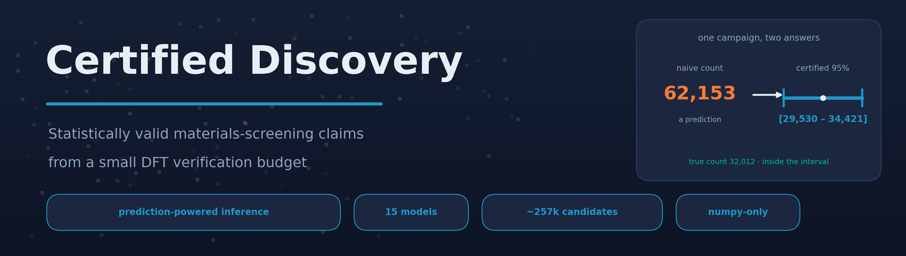
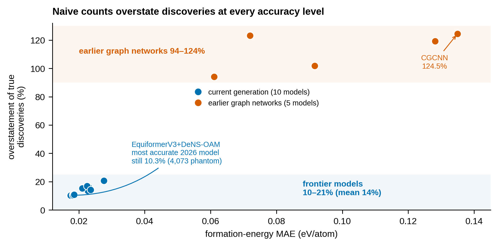
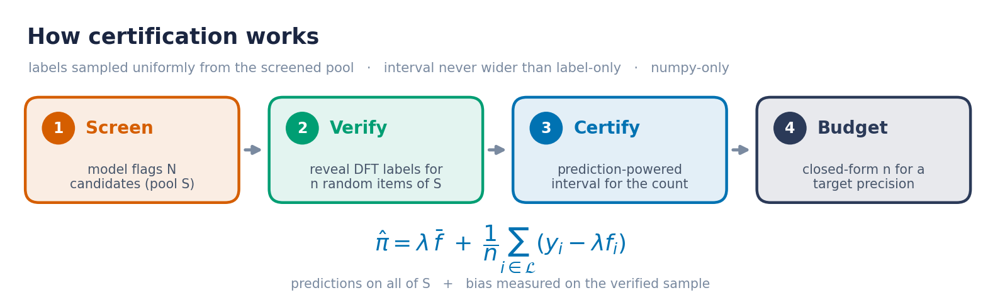
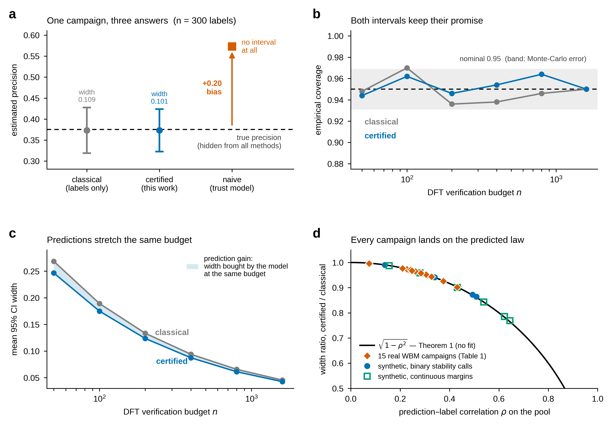
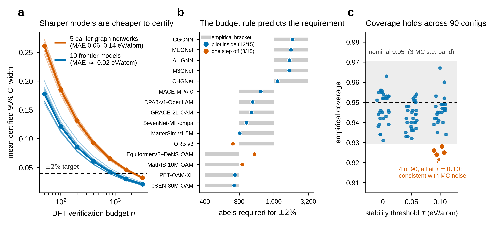

<div align="center">



<br/>

[](https://github.com/hasankurban/certified-discovery/actions/workflows/verify.yml)
[](https://www.python.org/)
[](LICENSE)
[](LICENSE-DATA)
[](pyproject.toml)
[](scripts/verify_results.py)

**Turn a headline discovery count into a confidence interval you can defend.**

[Quickstart](#quickstart) · [The result](#the-result) · [How it works](#how-it-works) · [Reproduce](#reproduce-the-paper) · [API](docs/API.md) · [Methods](docs/METHODS.md)

</div>

---

## Why this exists

Machine-learning models now screen millions of candidate crystals and report how
many new stable materials they found. Those counts are **model predictions
presented as measurements**: they inherit the model's unknown bias on the very set
the model selected, and they carry no statistical guarantee.

`certdisc` adapts **prediction-powered inference** to model-selected candidate
pools. With a small, uniformly random sample of DFT verifications it returns a
valid confidence interval for the precision of a flagged set, the count of truly
stable materials, and the difference between two models, plus a closed-form rule
for how large the verification budget must be.

## The result

Emulating certification campaigns for **15 public energy models** on the
exhaustively labelled ~257,000-candidate WBM corpus, naive counts overstate true
discoveries by **10% to 124%**. The overstatement shrinks with accuracy but never
disappears: even the most accurate 2026 model still announces roughly **one
phantom discovery in ten**.

<div align="center">

</div>

| | Overstatement (τ=0) | 500-label certified half-width | Empirical coverage |
|---|:---:|:---:|:---:|
| **Frontier models** (10) | 10–21% (mean 14%) | 2.6–3.2 pp | within nominal |
| **Earlier graph nets** (5) | 94–124% | 4.1–4.5 pp | within nominal |
| **All 90 configs** | — | — | 0.924–0.967 (median 0.945) |

Five hundred verifications — under 6% of the pool — certify discovery rates to
within **2.6–4.5 percentage points** at nominal 95% coverage.

## How it works

<div align="center">

</div>

All inference is **conditional on the screened pool** `S`, and labels must be
sampled uniformly at random *from* `S`. At `λ = 0` the estimator reduces to the
classical label-only interval; with an informative model it is never wider. See
[`docs/METHODS.md`](docs/METHODS.md) for the full statement and assumptions.

## Install

```bash
git clone https://github.com/hasankurban/certified-discovery.git
cd certified-discovery
pip install -e .                 # core estimators, numpy only
pip install -e ".[analysis]"     # + pandas/matplotlib/matbench-discovery to reproduce the paper
```

The core library depends on **numpy alone**.

## Quickstart

```python
import numpy as np
from certdisc import ppi_count_ci, imputation_estimate, required_budget

# A model flagged N candidates as stable. You can afford to DFT-verify n of them,
# drawn uniformly at random from the flagged set.
N = 62_153                         # size of the flagged set S
rng = np.random.default_rng(0)

# ground truth is hidden in practice; here we simulate a biased screener
y_true = (rng.random(N) < 0.515).astype(float)     # true stability of flagged items
f_pred = np.ones(N)                                # the model called all of them stable

# reveal labels for a random subsample of size n
n = 500
idx = rng.choice(N, size=n, replace=False)

naive = imputation_estimate(f_pred) * N            # what a naive campaign announces
iv = ppi_count_ci(y_true[idx], f_pred[idx], f_pred, alpha=0.05)   # certified interval

print(f"naive announced count : {naive:,.0f}")
print(f"certified 95% interval: [{iv.lower:,.0f}, {iv.upper:,.0f}]  (point {iv.estimate:,.0f})")

# how many labels would a +/-2% interval need? (from the rectifier variance)
rect_var = float(np.var(y_true[idx] - f_pred[idx], ddof=1))
print("budget for +/-2%:", required_budget(rect_var=rect_var, pool_size=N, half_width=0.02))
```

```text
naive announced count : 62,153
certified 95% interval: [30,856, 36,270]  (point 33,563)
budget for +/-2%: 2302
```

Every interval is an `Interval` with `.lower`, `.upper`, `.estimate`, `.width`.
Full study in [`notebooks/analysis.ipynb`](notebooks/analysis.ipynb); every
function in [`docs/API.md`](docs/API.md).

## Reproduce the paper

Every number is recomputed from the released result files by an independent
script, and every figure regenerates from the same data:

```bash
python scripts/verify_results.py        # reconciles all headline numbers -> 28/28 PASS
python scripts/build_figures.py         # regenerates the paper figures (vector PDF + 600 dpi PNG)
```

<details>
<summary><b>What the validation looks like</b> (click to expand)</summary>

<br/>

The estimators are calibrated, efficient, and follow the predicted efficiency law
on a synthetic positive control, then land on the same law for all 15 real
campaigns:

<div align="center">

</div>

Sharper models are cheaper to certify; the closed-form budget rule predicts the
requirement; coverage holds across all 90 configurations:

<div align="center">

</div>

</details>

The run of record: notebook build `2026-07-03-optionB-colfix-r6`, `N_REP = 1000`,
`N_LABEL = 500`, base seed `0`, τ ∈ {0, 0.05, 0.10} eV/atom, full and
unique-prototype pools; every file in [`data/`](data/) carries an SHA-256 checksum
in [`data/run_metadata.json`](data/run_metadata.json).

## Repository layout

```
certified-discovery/
├── src/certdisc/         # the estimator library (numpy-only)
│   ├── __init__.py       #   public API
│   └── core.py           #   PPI/PPI++, counts, paired diffs, budget rule, stratified PPI
├── scripts/
│   ├── verify_results.py #   independent re-derivation of every headline number (28/28)
│   └── build_figures.py  #   regenerates the figures from data/
├── notebooks/analysis.ipynb   # the full study, end to end
├── data/                 # per-figure / per-table source data + SHA-256 manifest
├── tests/                # unit tests + smoke test (pytest)
└── docs/                 # API reference, methods notes, and figure assets
```

The manuscript itself is not distributed here; it is available from Nature
Computational Science on publication (preprint on arXiv).

## Citing

Please cite the paper and the software (see [`CITATION.cff`](CITATION.cff)). A
`BibTeX` entry will be added on publication; the archived release will carry a
Zenodo DOI.

## License

Code under the [MIT License](LICENSE); the data files in `data/` under
[CC BY 4.0](LICENSE-DATA). The underlying WBM corpus and Matbench Discovery
prediction files remain the property of their respective authors; please cite them
when using this data.

## A note on scope

Certification is relative to the DFT oracle used to define stability, not to
experimental synthesizability. The estimators are domain-generic; the empirical
magnitudes here are specific to inorganic-crystal stability on the WBM corpus. The
library computes; it never asserts a fabricated outcome.
